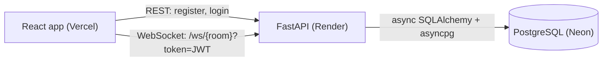

# RELAY

A real-time, multi-room chat app (built to the "Relay" spec). Log in, join any room by name, see who is online, catch up on the last 50 messages, and chat live over WebSockets.

- **Live app:** https://fastapi-realtime-chat.vercel.app/
- **API docs:** https://chatten-api.onrender.com/docs

> The backend runs on a free Render instance, which sleeps after 15 minutes without traffic. The first request after a quiet spell can take about a minute while it wakes up.

## Features

- Account registration and login with bcrypt-hashed passwords and JWT access tokens (30-minute expiry)
- Multi-room chat over WebSockets; any room name works
- Live presence: who is online in the room, plus join and leave notices
- The last 50 messages of a room are replayed when you join
- Token-validated WebSocket handshake: a bad or expired token is rejected before the connection opens
- Automatic reconnect with exponential backoff, and a clear message when your session expires
- Light and dark themes, responsive layout

## Architecture



| Part | Tech | Job |
| --- | --- | --- |
| `backend/` | FastAPI, SQLAlchemy (async), asyncpg, Alembic, PyJWT, passlib (bcrypt), Pydantic | REST auth, WebSocket rooms, persistence |
| `frontend/` | React 19, Vite, Tailwind CSS 4 | Login, rooms, chat UI, reconnecting WebSocket hook |
| Database | PostgreSQL (Neon) | `users` and `messages` tables, created by Alembic |

### How a message travels

1. The client logs in over REST and receives a JWT.
2. It opens `ws://.../ws/{room}?token=<jwt>`. The server decodes the token **before** accepting the connection.
3. The in-memory `ConnectionManager` registers the socket under that room. The client gets a `roster` event, the room gets a `presence` event, and the last 50 messages are replayed oldest first.
4. When a client sends `{"content": "hello"}`, the server validates it with Pydantic, **saves it to PostgreSQL**, then broadcasts it to every socket in the room.
5. On disconnect the socket is removed and the room gets an `offline` presence event.

Saving before broadcasting means anything a user sees is already durable. The cost is one database round trip of latency per message.

### Data model

| Table | Columns |
| --- | --- |
| `users` | `id`, `username` (unique), `hashed_pass` |
| `messages` | `id`, `room_id`, `content`, `created_at` (server default `now()`), `user_id` (FK to `users`) |

## API

### REST

| Method | Path | Body | Returns |
| --- | --- | --- | --- |
| POST | `/ws/register` | `{"username", "password"}` | `{"message": "User registered"}` |
| POST | `/ws/login` | `{"username", "password"}` | `{"access_token", "token_type": "bearer"}` |

Username: 3 to 50 characters. Password: at least 8 characters, with a digit and a special character. Login errors are deliberately generic (`Invalid credentials`) so they do not reveal whether a username exists.

### WebSocket: `/ws/{room_id}?token=<jwt>`

Client to server:

```json
{ "content": "hello" }
```

Server to client:

| `type` | Payload | When |
| --- | --- | --- |
| `roster` | `{"active_users": ["alice", "bob"]}` | Once, when you join |
| `presence` | `{"user": "bob", "status": "online" \| "offline"}` | Someone joins or leaves |
| `chat` | `{"user": "alice", "content": "hello"}` | Message history on join, then live messages |
| `error` | `{"content": "Invalid message format"}` | A malformed payload |

An invalid or expired token closes the connection with code 1008 (policy violation) during the handshake.

## Run it locally

You need Python 3.12 or newer (developed on 3.14), Node 20 or newer, and a PostgreSQL database.

### Backend

```bash
cd backend
python -m venv venv
# macOS / Linux:  source venv/bin/activate
# Windows (PowerShell):  .\venv\Scripts\Activate.ps1
pip install -r requirements.txt

cp .env.example .env     # then edit the values (see Configuration)
alembic upgrade head     # run from backend/, it creates the tables
uvicorn main:app --reload --port 8000
```

### Frontend

```bash
cd frontend
npm install
npm run dev              # http://localhost:5173
```

Open the app at `http://localhost:5173`, not `127.0.0.1`: CORS allows origins by exact match.

## Configuration

The same code runs everywhere; only the environment changes ([Twelve-Factor](https://12factor.net/config) style).

**Backend** (`backend/.env`, see `.env.example`):

| Variable | Purpose |
| --- | --- |
| `DATABASE_URL` | PostgreSQL URL. `postgres://` and `postgresql://` are converted to `postgresql+asyncpg://` automatically. |
| `SECRET_KEY` | Signs the JWTs. Use a long random value in production. |
| `CORS_ORIGINS` | Comma-separated list of allowed frontend origins. |
| `SQL_ECHO` | `true` logs every SQL statement. Defaults to `false`. |

On a hosted database that requires SSL, end the URL with `?ssl=require`. The `asyncpg` driver does not accept the `sslmode=` parameter that many providers show in their connection strings.

**Frontend** (`frontend/.env`):

| Variable | Purpose |
| --- | --- |
| `VITE_API_URL` | Backend address. The WebSocket address is derived from it (`https` becomes `wss`). |

Values starting with `VITE_` are baked into the built files at build time and are public. Never put a secret in one.

## Deployment

| Piece | Host | Settings |
| --- | --- | --- |
| Database | Neon (PostgreSQL) | Direct (non-pooled) connection string, ending in `?ssl=require` |
| Backend | Render (free web service) | Root directory `backend`; build `pip install -r requirements.txt`; start `uvicorn main:app --host 0.0.0.0 --port $PORT`; set `DATABASE_URL`, `SECRET_KEY`, `CORS_ORIGINS` |
| Frontend | Vercel | Root directory `frontend`; set `VITE_API_URL` to the Render address |

Migrations are run by hand against the hosted database (set `DATABASE_URL` in your terminal, then `alembic upgrade head` from `backend/`). Render does not run them during a deploy.

## Design notes

- **In-memory connection manager.** Open sockets are tracked in a dictionary (`room -> {socket: username}`) inside the server process. It is simple and fast, and it fits temporary state that does not need to survive a restart. Users and messages, which do, are stored in PostgreSQL.
- **Fully async stack.** `asyncpg` with async SQLAlchemy means waiting on the database does not block other connections.
- **Token in the query string.** Browsers cannot set custom headers on a WebSocket, so the JWT travels in the URL. The trade-off is that URLs can end up in logs.
- **Reconnect logic lives in one hook.** `useChatSocket` owns the connection, retries with backoff (1 s, 2 s, 4 s, ... capped at 15 s), and clears the message list on every connect because the server replays history each time.

## Known limitations

- **Single instance only.** Connected users live in one process's memory, so with two server instances people on different instances would not see each other's live messages. The fix is Redis pub/sub: each instance publishes messages to a channel per room and delivers them to its own local sockets. Not implemented.
- **Broadcast is sequential.** One slow client can delay delivery to others in the room. `asyncio.gather` with per-send timeouts, or a send queue per connection, would fix it.
- **Presence is keyed by username.** A user connected in two tabs shows as offline when either tab closes. Counting connections per user would fix it.
- **Cleanup only runs on a normal disconnect.** Other exceptions inside the socket loop skip the removal step. A `try/finally` would fix it.
- **No WebSocket `Origin` check.** CORS does not apply to WebSockets.
- **Password hashing blocks the event loop.** bcrypt is CPU-bound and runs inside async endpoints. Moving it to a thread pool would fix it.
- **History is the latest 50 messages only.** There is no pagination. Keyset pagination (`WHERE id < :cursor ORDER BY id DESC LIMIT 50`) would be the next step.
- **Tokens live in `localStorage`.** Readable by any injected script. HttpOnly cookies or short-lived tokens with refresh would be safer.
- **Free-tier cold starts** on Render, as noted above.

## Roadmap

- [ ] Automated backend tests (pytest) and a GitHub Actions workflow
- [ ] Dockerfile and docker-compose for local development
- [ ] Redis pub/sub for multi-instance scaling
- [ ] Keyset-paginated history with scroll-up loading
- [ ] Fix the presence and cleanup issues listed above
